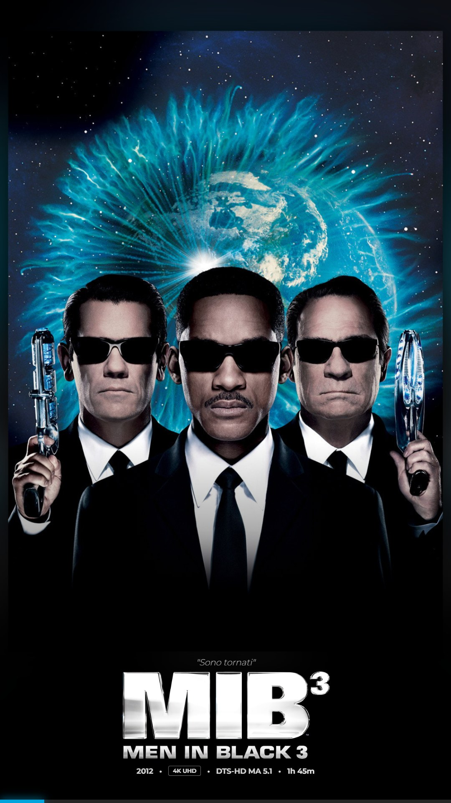
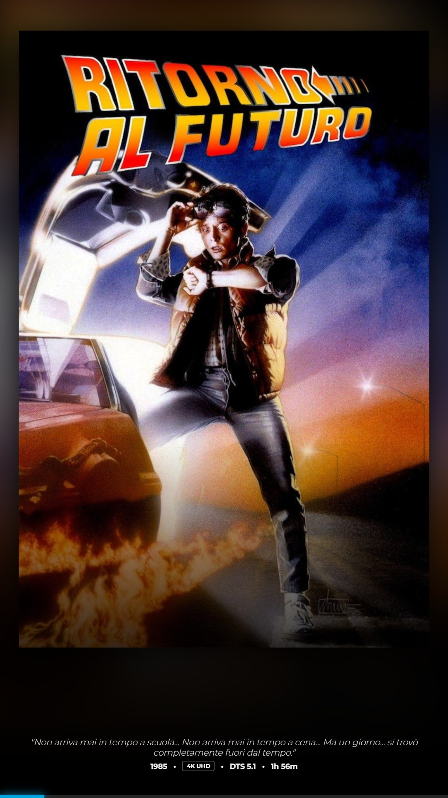
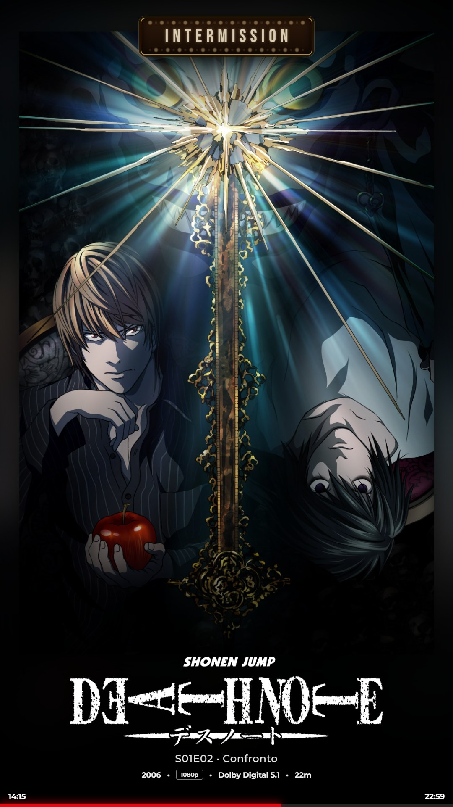
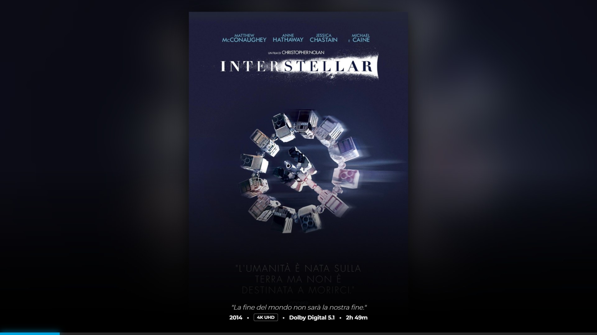

# 🎬 Jellyfin Cinema Poster


A beautiful, immersive digital signage solution for your Home Theater. This application turns any vertical monitor into a **dynamic digital poster** that cycles through your Jellyfin library and automatically switches to a "Now Playing" mode when a movie starts.

Designed with a premium "Cinema Grade" aesthetic, featuring smooth animations, metadata badges, and deep immersion.

---

## ✨ Features

* **🔄 Smart Carousel:** Randomly cycles through movies in your library with a smooth "Ken Burns" zoom effect and a crossfade between posters (no fade to black). The time per poster is configurable.
* **⚡ Now Playing Detection:** Automatically interrupts the carousel (within ~3 seconds) when you start watching a movie or a TV episode.
    * Displays a cinema marquee sign with chasing light bulbs: "NOW PLAYING", or "INTERMISSION" (lights off) when playback is paused.
    * Shows a live progress bar synced with your playback.
    * Displays start/end times and formatted duration.
    * TV episodes show the series poster and logo, with `S01E02 · Episode title` below the title.
* **🏷️ Title Logos:** Uses the movie's official title logo from Jellyfin when available, falling back to text.
* **🔎 No Duplicate Titles:** Most posters already have the title printed on them. With `SHOW_TITLE=auto` the app looks for the movie's logo inside the poster and hides the title when it's found (see [How title detection works](#-how-title-detection-works)).
* **🖥️ Multi-Screen Sync:** Optionally guarantees that multiple screens never show the same movie at the same time.
* **📱 Vertical Optimization:** Specifically designed for 9:16 vertical monitors (Digital Posters), but works on standard screens too.
* **🎨 Immersive UI:**
    * High-quality backdrop blurs.
    * Edge-to-edge progress bars.
    * High-contrast typography (Bebas Neue & Montserrat).
    * Metadata badges: year, resolution (4K UHD / 1080p / 720p), audio format (e.g. `TrueHD Atmos 7.1`, `DTS-HD MA 5.1`) and duration.
* **🤖 Zero Config User:** Automatically detects the primary user on your Jellyfin server.

---

## 📸 Screenshots

| Carousel: title logo from Jellyfin | Carousel: title already on the poster (hidden automatically) |
|:---:|:---:|
|  |  |
| **Now Playing: movie** | **Now Playing: TV episode, paused** |
|  |  |

| Standard (landscape) screen |
|:---:|
|  |

---

## 🛠️ Prerequisites

* **Python 3.11+** installed on your machine (tested up to Python 3.15), or **Docker**.
* A running **Jellyfin Server** (tested with Jellyfin 12; the app uses the standard `Authorization: MediaBrowser ...` header, which also works with older 10.x servers).
* A Jellyfin **API Key**.
* Optional: **OpenCV** (installed by `requirements.txt`) for automatic title detection. Without it the app still works and simply always shows the title.

### How to get your API Key
1.  Open your Jellyfin Dashboard.
2.  Go to **Advanced** > **API Keys**.
3.  Click **+** to create a new key.
4.  Name it "CinemaPoster" and copy the generated key.

---

## 🚀 Installation

1.  **Clone the repository:**
    ```bash
    git clone https://github.com/simoneluconi/jellyfin-poster.git
    cd jellyfin-poster
    ```

2.  **Install dependencies:**
    It is recommended to use a virtual environment.
    ```bash
    pip install -r requirements.txt
    ```

3.  **Configuration:**
    Rename the example environment file to `.env`:
    ```bash
    mv .env.example .env
    ```
    
    Open `.env` with a text editor and fill in your details:
    ```ini
    JELLYFIN_URL=your_jellyfin_url_here # Your Jellyfin IP and Port
    JELLYFIN_API_KEY=your_long_api_key_here
    PORT=5000
    DEBUG=False
    POSTER_DURATION=30
    SHOW_TITLE=auto
    SHOW_LOGOS=True
    SYNC_SCREENS=False
    ```

    | Variable | Default | Description |
    |---|---|---|
    | `JELLYFIN_URL` | — | Address of your Jellyfin server, e.g. `http://192.168.1.10:8096`. |
    | `JELLYFIN_API_KEY` | — | API key created in the Jellyfin dashboard. |
    | `PORT` | `5000` | Port of the poster web page. |
    | `DEBUG` | `False` | Flask debug mode. Keep it off: the app listens on the whole network. |
    | `POSTER_DURATION` | `30` | Seconds each poster stays on screen in carousel mode (minimum 5). |
    | `SHOW_TITLE` | `auto` | `auto`: hide the title when the movie's logo is already printed on the poster. `True`: always show it. `False`: never show it. Tagline and badges stay visible in every case. |
    | `SHOW_LOGOS` | `True` | Show the title logo image from Jellyfin instead of the text title, when the movie has one. |
    | `SYNC_SCREENS` | `False` | With several screens connected, never show the same movie on two of them at once. This also applies to "Now Playing": only one screen shows a playing movie, the others keep cycling. |

---

## ▶️ Usage

1.  **Start the server:**
    ```bash
    python app.py
    ```

2.  **Open the display:**
    Open a web browser on the device connected to your vertical monitor and navigate to:
    `http://localhost:5000` (or your PC's IP address).

3.  **Kiosk Mode (Full Screen):**
    * **Chrome/Edge:** Press `F11` to enter full screen.
    * **Auto-start tip:** You can launch Chrome in kiosk mode via command line:
        ```bash
        chrome.exe --kiosk http://localhost:5000 --incognito
        ```

4.  **Docker (alternative):** set your Jellyfin URL and API key (and any option from the table above) in `docker-compose.yml`, then:
    ```bash
    docker compose up -d --build
    ```
    Title detection results are kept in the `./cache` folder mounted into the container. The `.env` file is not copied into the image (see `.dockerignore`): with Docker, configure everything in `docker-compose.yml`.

5.  **Multiple screens:** open the same URL on every screen. Each browser tab is tracked as a separate screen; enable `SYNC_SCREENS=True` to keep them all showing different movies. A screen that is closed frees its movie immediately (or after 90 seconds if it simply loses connection).

---

## 🔎 How title detection works

With `SHOW_TITLE=auto`, the app decides for each movie whether the title is already printed on the poster:

1. It takes the movie's **logo** from Jellyfin (the same image shown as title) and searches for it inside the **poster** using OpenCV SIFT feature matching.
2. The matches must fit a plausible placement: the logo resized, moved and rotated by at most 40°, inside the poster. Random similarities between unrelated images don't fit this model.
3. Five versions of the logo are tried (original colors on dark and light backgrounds, inverted, and its bare shape in both polarities), so a logo printed in different colors on the poster is still recognised.
4. If enough features match (`MATCH_THRESHOLD` in [title_detection.py](title_detection.py)), the title is hidden; otherwise the logo is shown as usual.

All movies are analysed once in the background when the server starts (about 0.2 s per movie), and results are cached in `cache/title_detection.json`. Replacing a poster or logo in Jellyfin changes its image tag, so that movie is analysed again automatically. Movies without a logo always show the text title.

**Accuracy.** Tested on the posters of a real library plus TMDB posters of movies outside it: no textless poster and no unrelated logo/poster pair ever passed the threshold. When a poster's title uses a different design from the logo (different font, layout or language), detection fails safe: the title is simply shown, as with `SHOW_TITLE=True`.

---

## 📂 Project Structure

```text
jellyfin-poster/
├── app.py              # Main Python/Flask backend logic
├── title_detection.py  # Finds the title logo printed on a poster (SHOW_TITLE=auto)
├── requirements.txt    # Python dependencies
├── Dockerfile          # Container image
├── docker-compose.yml  # Docker setup (configuration + cache volume)
├── .env                # Private configuration (Excluded from Git)
├── .env.example        # Public configuration template
├── cache/              # Title detection results (created at runtime, excluded from Git)
└── templates/
    └── poster.html     # The Frontend (HTML/CSS/JS)
```

---

## 🧰 Troubleshooting

* **The page stays on a black screen / "Loading..."**: the server can't reach Jellyfin. Check `JELLYFIN_URL` and that the API key is still valid; errors are printed in the server console.
* **`SHOW_TITLE=auto needs opencv-python-headless`** in the log: run `pip install -r requirements.txt`. Until then titles are always shown.
* **A poster shows the title twice**: its printed title uses a different design from the Jellyfin logo, so it wasn't recognised. Pick a different logo or poster in Jellyfin, or set `SHOW_TITLE=False`.